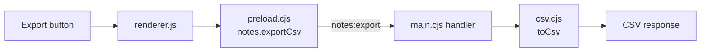

# Trace an Electron CSV export

Follow one button through a renderer, preload bridge, IPC channel, and main-process handler. This repository owns the small target fixture, so every file can be inspected and redistributed under the root MIT license.

**Verified:** REA 6.5.0 static analysis on macOS arm64 with Node.js 26.8.1, plus three fixture behavior tests. **Not executed:** the Electron desktop UI, an LLM investigation, or an independently reconstructed implementation. The target has Electron-shaped source files; Electron itself is not bundled or installed for this lab.

## Question

What happens when the user selects **Export CSV**, and how are commas, quotes, and embedded newlines represented?

Before reading the answer, ask an agent to identify the path using source locations and to distinguish observed syntax from inferred runtime behavior.

## Reproduce

Run these commands from the repository root. Use Python 3.10+ and a Node version supported by REA 6.5.0: `^22.19.0`, `^24.11.0`, or `>=26.0.0`. Linux additionally needs a procps-compatible `ps` on `PATH`; see the [upstream prerequisite](https://github.com/morluto/rea/blob/main/docs/installation.md).

```sh
node --test labs/electron-notes/app/csv.test.cjs
mkdir -p labs/electron-notes/output
npx -y rea-agents@6.5.0 analyze-javascript-application "$PWD/labs/electron-notes/app" --json > labs/electron-notes/output/rea-evidence.json
python3 scripts/verify_evidence.py labs/electron-notes/output/rea-evidence.json
```

The `npx` command downloads the fixed upstream release and its dependencies on first use. It analyzes the local files without starting the fixture's desktop UI or registering a new MCP server. The raw output stays in the ignored `output/` directory because it contains local paths. These POSIX-shell commands work in macOS/Linux; for PowerShell use an absolute target path as described in the upstream guide.

## Expected trace

| Step | Source | Observation |
| --- | --- | --- |
| 1 | [renderer.js](app/renderer.js) | The click listener calls `window.notes.exportCsv()` |
| 2 | [preload.cjs](app/preload.cjs) | `contextBridge` exposes `notes.exportCsv`, which invokes `notes:export` |
| 3 | [main.cjs](app/main.cjs) | The handler for `notes:export` returns a filename, MIME type, and `toCsv(notes)` |
| 4 | [csv.cjs](app/csv.cjs) | Cells containing commas, quotes, or line breaks are quoted; embedded quotes are doubled |
| 5 | [renderer.js](app/renderer.js) | The response becomes a Blob and a download link |

This trace is directly inspectable in the fixture source. The recorded REA checks establish the bridge and IPC observations and their source locations; they do not prove that every step executes at runtime.



## Recorded result

The [verification receipt](verification.json) records the input hashes, package integrity, environment, and observed counts. The run read 7 relevant files, parsed 5 JavaScript files, and reported 0 parse failures. It found 1 BrowserWindow, 1 preload entry point, 1 exposed bridge API, and 1 literal IPC channel with a paired renderer transmission.

The three Node tests independently check the fixture's CSV transformation for punctuation and embedded newlines, an empty collection, and missing/numeric fields. They test the original transformation; they are not a test of an LLM-generated reconstruction.

REA reported application-graph coverage as `complete` and semantic-graph coverage as `unknown`. These labels refer to different analysis layers. Static edges do not establish runtime reachability, security enforcement, or complete program semantics. No commercial application or binary was tested by this lab.

## Extend the exercise

Try changing the IPC channel on one side only and inspect the resulting unpaired transmission. Or add a second export format and ask which evidence distinguishes it. The fixture hash check will intentionally fail after edits; keep experimental changes separate from the published baseline and compare fresh Evidence files.

Sources: [official CLI guide](https://github.com/morluto/rea/blob/main/docs/cli.md), [JavaScript application workflows](https://github.com/morluto/rea/blob/main/docs/javascript-application-workflows.md), [published package](https://www.npmjs.com/package/rea-agents/v/6.5.0).
